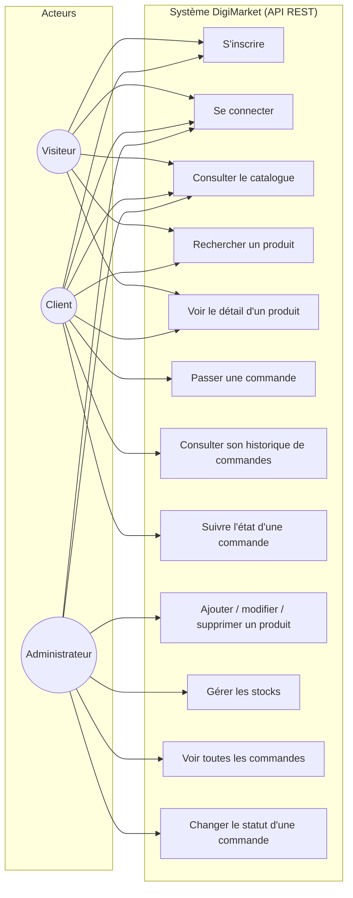

# ÉTAPE 1 appliquée à DigiMarket — Use cases : cas d'utilisation (QUI fait QUOI ?)

⏱️ **~45 min — facile**

**Question** : à partir de la liste de l'étape 0 (`etape0-AFB.md`), **QUI** sont les acteurs et **QUOI** veulent-ils faire ?
**Outil** : **diagramme de cas d'utilisation** (bonhomme + bulles) **+ matrice des rôles**.

## Acteurs (un acteur = un rôle joué, pas une personne)
- **Visiteur** : personne non connectée.
- **Client** : utilisateur connecté avec le rôle `client`.
- **Administrateur** : utilisateur connecté avec le rôle `admin`.

## Diagramme de cas d'utilisation

## Matrice des rôles (qui a le DROIT de faire chaque cas ?)

| Cas d'utilisation | Visiteur | Client | Admin |
|---|---|---|---|
| S'inscrire | ✅ | ✅ | (créé hors système) |
| Se connecter | ✅ | ✅ | ✅ |
| Consulter le catalogue / rechercher / détail produit | ✅ | ✅ | ✅ |
| Passer une commande | ❌ | ✅ | ✅ |
| Consulter SON historique de commandes | ❌ | ✅ | ❌ |
| Suivre l'état d'une commande | ❌ | ✅ (la sienne) | ✅ (toutes) |
| Ajouter / modifier / supprimer un produit | ❌ | ❌ | ✅ |
| Gérer les stocks | ❌ | ❌ | ✅ |
| Voir TOUTES les commandes | ❌ | ❌ | ✅ |
| Changer le statut d'une commande | ❌ | ❌ | ✅ |

**Règle métier déduite** : un client ne voit que **ses propres** commandes (sinon erreur `403`).

---

✅ **Checklist étape 1** :
- [x] chaque besoin de l'étape 0 est couvert par au moins un cas (matrice besoins ↔ cas) ;
- [x] chaque cas = un verbe à l'infinitif ;
- [x] la matrice des rôles est complète (une croix par cas).

⚠️ **Pièges évités** : oublier les cas publics (Visiteur) ; donner tous les droits à tout le monde.

🧰 **Bonnes pratiques à ce stade** :
- matrice de traçabilité commencée (besoin → cas) ;
- README : section « Fonctionnalités » = liste des cas ci-dessus ;
- commit Git de cette étape (ce push).

🧵 **Fil rouge** : l'acteur **Visiteur** a le cas **« S'inscrire »** → deviendra la route `POST /api/auth/register`.

❓ **Auto-évaluation** :
1. Pourquoi un acteur est-il un rôle et pas une personne ?
2. Citez un cas réservé à l'admin.
3. Pourquoi le client ne voit-il que ses commandes ?

📝 **À retenir (3 lignes)** :
1) Acteur = rôle joué devant le système (Visiteur, Client, Admin).
2) Cas = verbe à l'infinitif (« Passer une commande »).
3) La matrice des rôles dit qui a le droit de faire chaque cas.

---
*Étape 1 ✅ terminée. En attente de votre accord pour l'étape 2 (fonctions métier).*
