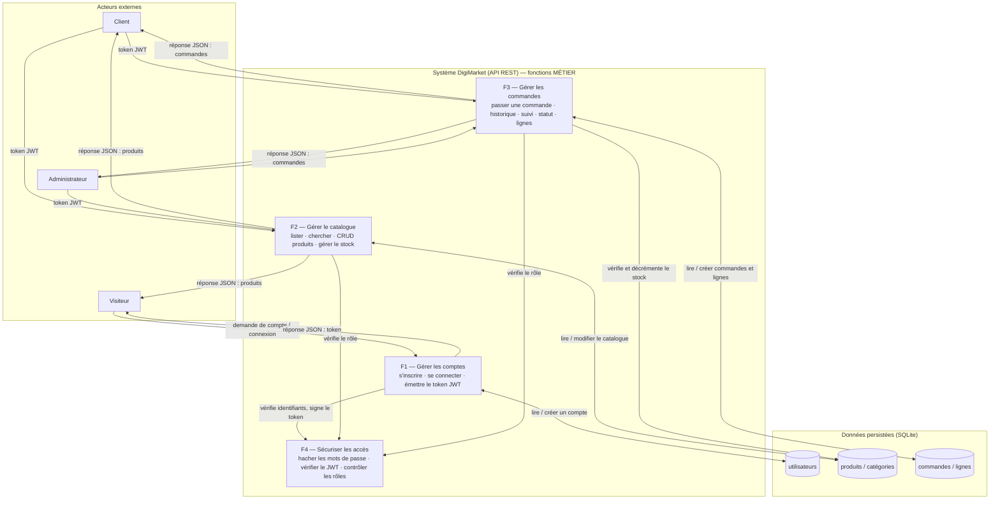
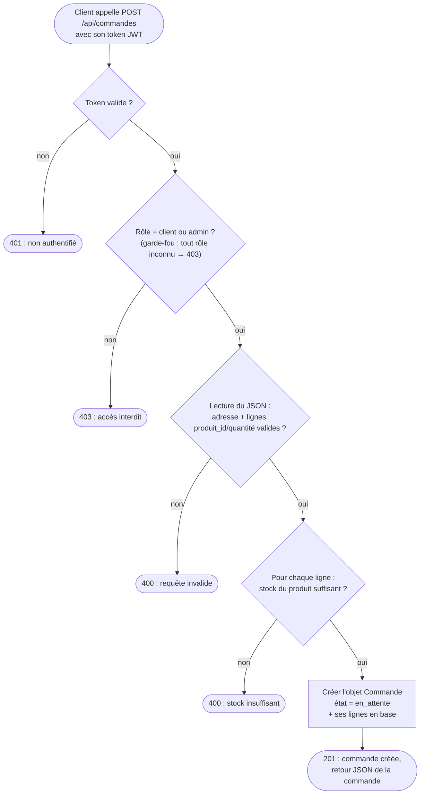

# ÉTAPE 2 appliquée à DigiMarket — Fonctions MÉTIER du système

⏱️ **~1 h — moyenne**

**Question** : quelles **ACTIONS globales internes** (fonctions métier) réalisent les cas de l'étape 1 ?
**Rappel** : une fonction métier = une action (verbe + complément), PAS une fonction Python. Test du « une phrase » : chaque fonction métier tient en une seule phrase.

## Les 4 fonctions métier de DigiMarket

| Bloc | Fonction métier (action) | Cas réalisés (étape 1) |
|---|---|---|
| **F1** | Gérer les comptes | S'inscrire, Se connecter |
| **F2** | Gérer le catalogue | Consulter, Rechercher, Détail produit, Ajouter/Modifier/Supprimer un produit, Gérer les stocks |
| **F3** | Gérer les commandes | Passer une commande, Historique, Suivi d'état, Voir toutes les commandes, Changer le statut |
| **F4** | Sécuriser les accès | (transversal : vérifie le token JWT et le rôle sur chaque requête protégée) |

## Diagramme fonctionnel (blocs d'actions + flux de données)

## Diagramme de flux — la fonction métier complexe « Passer une commande » (F3)

💡 Le `403` est un **garde-fou** : avec seulement 2 rôles (client, admin) et un token obligatoire, la branche « non » est normalement inatteignable — mais elle protège si un jour un rôle inconnu/invalide apparaît (bonne pratique : jamais de confiance aveugle côté serveur).

---

✅ **Checklist étape 2** :
- [x] chaque fonction métier réalise au moins un cas de l'étape 1 (traçabilité) ;
- [x] chaque fonction métier tient en une seule phrase.

⚠️ **Piège évité** : confondre fonction métier (F1 « Gérer les comptes ») et fonction Python.

🧰 **Bonnes pratiques à ce stade** :
- traçabilité poursuivie (cas → fonction métier, voir tableau ci-dessus) ;
- commit Git de cette étape (ce push).

🧵 **Fil rouge** : le cas « S'inscrire » est réalisé par **F1 « Gérer les comptes »** ; son flux : données valides ? email unique ? → créer le compte / sinon erreur `409`.

❓ **Auto-évaluation** :
1. Quelle fonction métier réalise « S'inscrire » ?
2. Fonction métier ou fonction Python : quelle différence ?
3. Pourquoi ne détailler qu'UN seul flux (celui de « Passer une commande ») ?

📝 **À retenir (3 lignes)** :
1) Fonction métier = action globale (F1–F4), tient en une phrase.
2) Le diagramme fonctionnel montre les blocs + les flux vers la base.
3) On détaille UN seul flux complexe (ici « Passer une commande »).

---
*Étape 2 ✅ terminée. En attente de votre accord pour l'étape 3 (objets).*
