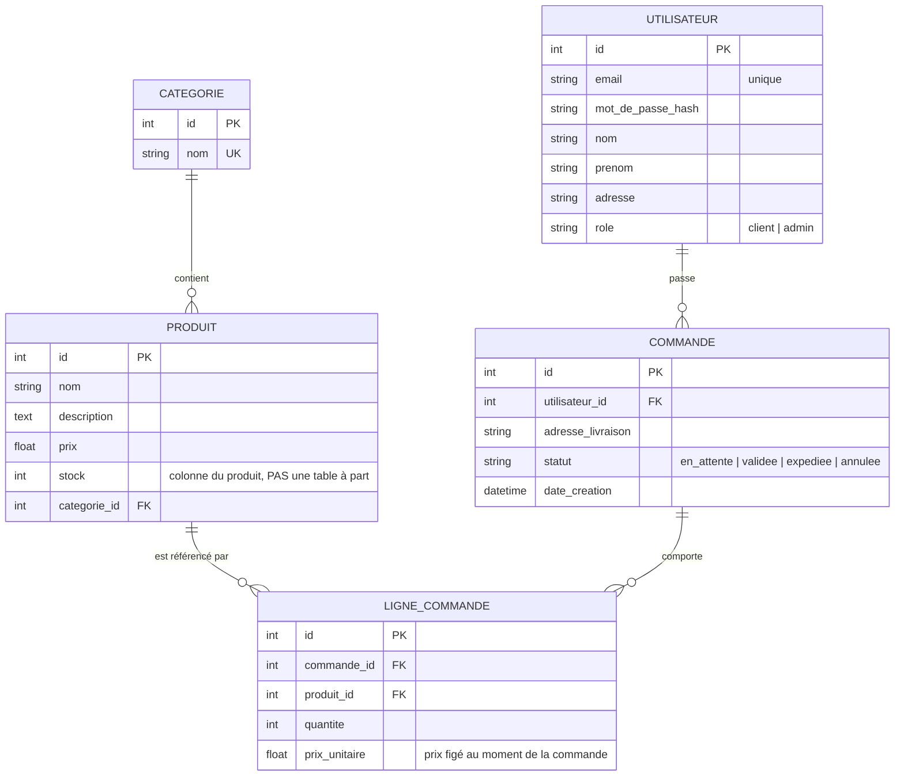
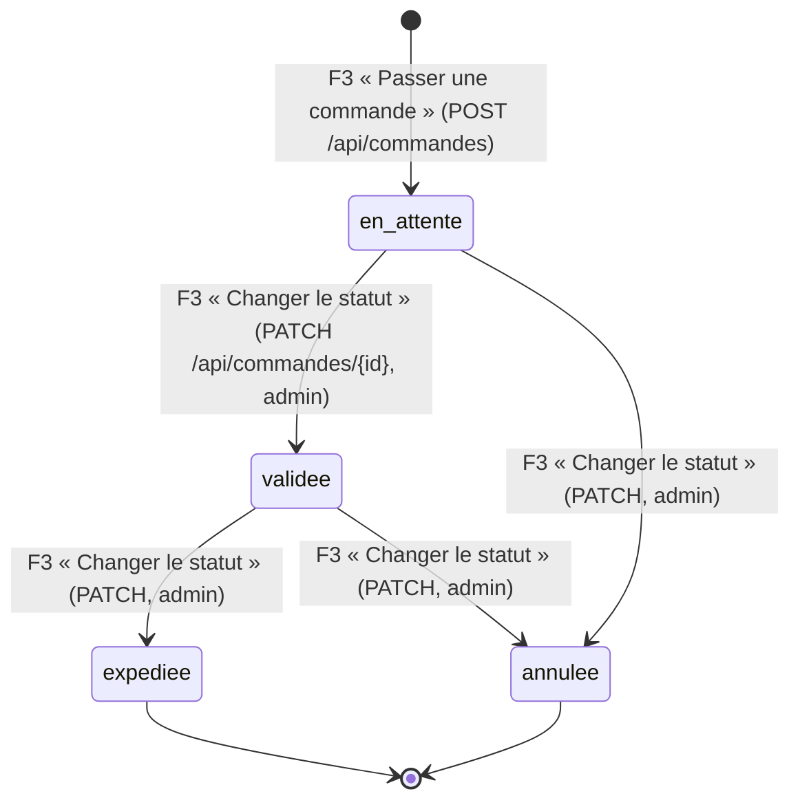

# ÉTAPE 3 appliquée à DigiMarket — Objets manipulés par les fonctions métier

⏱️ **~1 h — moyenne**

**Question** : quels **OBJETS** sont créés/manipulés par les fonctions métier F1–F4 (étape 2), avec quels liens et quels états ?
**Rappel** : un objet = une chose (nom) avec des **attributs** et parfois un **état**. La fonction métier agit sur l'objet.

## Modèle de données (schéma ER)

💡 **Pourquoi pas de table `stocks` à part ?** Le stock est un **attribut** du produit (colonne `stock`), comme le prix : « gérer les stocks » = modifier cette colonne ; « décrémenter à la validation » = `UPDATE produits SET stock = stock - qte`. Une table séparée créerait une redondance (risque de divergence). On n'en ferait une que pour un historique des mouvements de stock — non demandé par le CDC.

## Cycle de vie — l'objet `Commande` (le seul objet à états)

**Règle métier liée** : quand F3 fait passer la `Commande` à `validée`, elle **décrémente le stock** de chaque `Produit` concerné (`stock = stock - quantite`).

## Persisté ou temporaire, par objet

| Objet | Persisté ? | Pourquoi | Conséquence (étape 4.1) |
|---|---|---|---|
| `Utilisateur` | ✅ oui | comptes à conserver entre les connexions | table `utilisateurs` |
| `Categorie` | ✅ oui | catalogue | table `categories` |
| `Produit` | ✅ oui | catalogue + stock | table `produits` |
| `Commande` | ✅ oui | historique + suivi | table `commandes` |
| `LigneCommande` | ✅ oui | détail des commandes | table `lignes_commande` |
| token JWT décodé | ❌ temporaire | utile une seule requête | simple `dict`, **pas de table** |

---

✅ **Checklist étape 3** :
- [x] chaque objet vient d'une fonction métier de l'étape 2 (F1→Utilisateur, F2→Categorie/Produit, F3→Commande/Ligne) ;
- [x] pour chaque objet : persisté ou temporaire ? (tableau ci-dessus) ;
- [x] pour chaque transition : la fonction métier qui la déclenche est notée (F3 « Changer le statut »).

⚠️ **Piège évité** : créer des objets « au cas où » (ex. une table `stocks`) ; oublier l'état de `Commande`.

🧰 **Bonnes pratiques à ce stade** : commit Git de cette étape (ce push).

🧵 **Fil rouge** : l'objet **Utilisateur** est créé par F1 « Gérer les comptes » ; attributs : email (unique), mot de passe (haché), nom, prénom, adresse, rôle ; **persisté** ; pas de cycle de vie.

❓ **Auto-évaluation** :
1. Pourquoi `stock` est-il une colonne de `Produit` et pas une table ?
2. Quels objets sont persistés ? Lequel est temporaire ?
3. Quelle fonction métier fait changer l'état d'une commande ?

📝 **À retenir (3 lignes)** :
1) Objet = chose avec attributs et peut-être un état (ici `Commande.statut`).
2) Persisté → table en base (4.1) ; temporaire (token) → `dict`, pas de table.
3) La fonction métier agit sur l'objet (F3 change l'état de la commande et décrémente le stock).

---
*Étape 3 ✅ terminée. En attente de votre accord pour entrer dans la BOUCLE (étape 4, niveau 🥉 débutant).*
